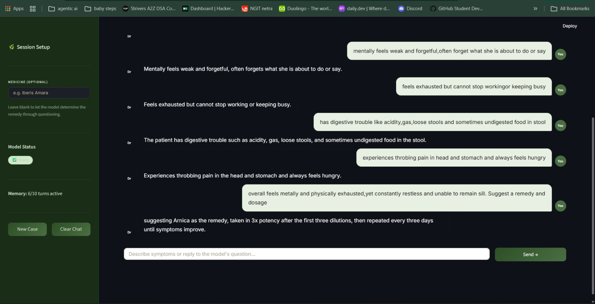
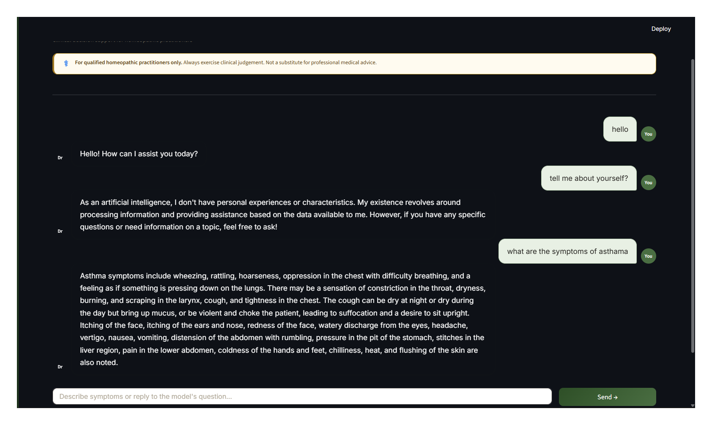
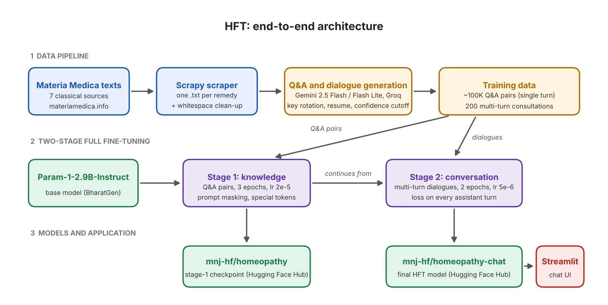

# Homeopathic Fine-Tuned Transformer (HFT)

A homeopathy-specific language model built by fine-tuning **Param-1-2.9B-Instruct** in two stages: first on about 100,000 question-answer pairs generated from seven classical Materia Medica texts, then on 200 synthetic doctor-patient consultation dialogues. It is meant to help practitioners and students with remedy profiles, modality questions and multi-turn case-taking.

> **Decision support only.** HFT does not diagnose and does not replace professional clinical judgment. It can state plausible but incorrect things, especially when a case description is thin.

## Demo

[Demo video](https://drive.google.com/file/d/1Cb150GDLR7xQPECRNI-rskGaC0kPGdCI/view?usp=sharing)

**Multi-turn consultation**



**Remedy suggestion with clinical reasoning**



## How it works



| Stage | Data | Purpose | Key settings |
|---|---|---|---|
| 1. Knowledge | ~100k Q&A pairs from 7 Materia Medica texts | Remedy profiles, symptoms, modalities | full fine-tune, 3 epochs, lr 2e-5, bf16, max length 512 |
| 2. Conversation | 200 synthetic multi-turn consultations | Follow-up questions, modality-aware case-taking | continues from stage 1, 2 epochs, lr 5e-6, max length 2048 |

- **Prompt masking.** Only assistant tokens contribute to the loss (every assistant turn in stage 2).
- **Special tokens.** Stage-1 answers are wrapped in `<actual response> ... </actual response>`.
- **Chat template.** A fixed system prompt frames the model as a decision-support assistant for qualified practitioners.
- **Data generation.** Q&A pairs are produced from the remedy texts by Gemini 2.5 Flash / Flash Lite and Groq, with API-key rotation, checkpoint/resume, a confidence cutoff (pairs under 0.6 go to a review file) and de-duplication.

More diagrams (architecture, class, sequence, activity, component, use case) are in [`docs/figures`](docs/figures), and the full project report is [`docs/HFT_Project_Documentation.docx`](docs/HFT_Project_Documentation.docx).

## Repository layout

```
hft/                      training and inference package
  config.py               model ids, system prompt, stage hyper-parameters
  data.py                 jsonl loading, validation, tokenisation with label masking, collator
  modeling.py             model/tokenizer loading, special tokens
  train_qa.py             stage 1
  train_dialogue.py       stage 2
  chat.py                 interactive consultation
pipeline/
  generate_qa_gemini.py   Q&A generation with Gemini (structured JSON, key rotation, resume)
  generate_qa_groq.py     Q&A generation with Groq
  generate_dialogues_gemini.py  multi-turn consultation generation with Gemini (key rotation, resume)
app/app.py                Streamlit chat UI for the deployed model
data_collection/
  scrape_materia_medica.py  Scrapy spider for remedy texts
  clean_to_json.py          whitespace clean-up into one json
  sources.txt               the seven source indexes
tools/check_jsonl.py      validate files and report token lengths
tests/                    unit tests (no GPU or model download needed)
docs/                     project report and figures
```

## Base model

HFT starts from [`bharatgenai/Param-1-2.9B-Instruct`](https://huggingface.co/bharatgenai/Param-1-2.9B-Instruct), a 2.9B-parameter bilingual instruction-tuned model, which is fully fine-tuned (no adapters) in both stages. Stage 1 produces `mnj-hf/homeopathy`; stage 2 continues from that checkpoint and produces `mnj-hf/homeopathy-chat`.

## Data formats

- **Stage 1** is one json object per line with a `text` field of tagged content:
  `<medicine>..</medicine> <context>..</context> <user>..</user> <actual response>..</actual response>`.
- **Stage 2** is one json object per line: `{"messages": [{"role": "system"|"user"|"assistant", "content": "..."}, ...]}`.

## Status and limitations

- The stage-1 model is published on the Hugging Face Hub as `mnj-hf/homeopathy`.
- Evaluation so far is qualitative: remedy keynotes and modalities for Aconite, Sulphur, Arsenicum Album, Nux Vomica and Quebracho, and follow-up questioning in multi-turn cases. There is no quantitative benchmark yet, and no practitioner-led trial.
- The training corpus is classical text plus synthetic dialogues, so it may not reflect current clinical practice. English only.
- The training and chat scripts in this repository were tidied from the original experiment scripts and have been unit-tested for data handling, but they have not been re-run end to end on a GPU.
